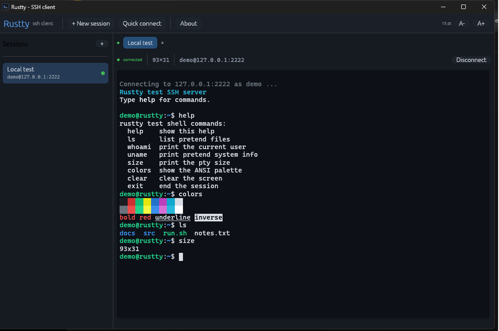
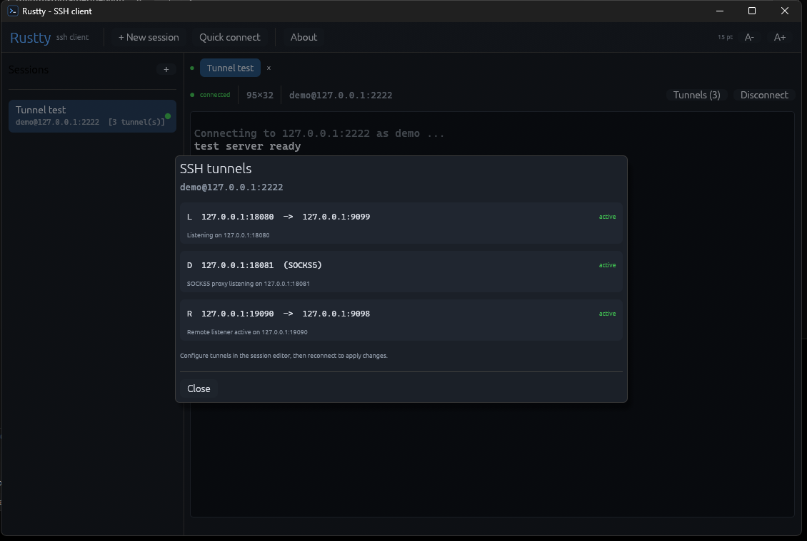

# Rustty

A small PuTTY-style SSH terminal client written in Rust. It uses
[`egui`](https://github.com/emilk/egui) for the GUI, [`russh`](https://github.com/warp-tech/russh)
for SSH and [`vt100`](https://github.com/doy/vt100-rust) for terminal emulation.



## Features

- Saved sessions with host, port, username, authentication method and terminal type
- Password or private-key authentication (OpenSSH/PEM, optional passphrase)
- Host-key verification with SHA-256 fingerprints stored in `known_hosts.json`;
  unknown keys are shown for approval and changed keys produce a warning
- Multiple concurrent sessions in tabs
- SSH tunnels per session: local port forwarding (`-L`), remote port
  forwarding (`-R`) and a dynamic SOCKS5 proxy (`-D`)
- xterm-compatible terminal with 256-color/true-color support, bold, dim,
  inverse and underline attributes
- 10,000 lines of scrollback, mouse-wheel scrolling and Shift+PageUp/PageDown
- Mouse text selection, copy and bracketed paste
- Automatic terminal resizing over the SSH `window-change` request
- Connection keepalives and a reconnect/credential prompt after a failure
- Quick connect without saving a session

## Build and run

Requires Rust 1.89 or newer.

```sh
cargo run --release
```

On Windows the release executable is `target/release/rustty.exe` (or
`target\release\rustty.exe`). The release build uses the Windows GUI subsystem,
so no console window is opened. A prebuilt copy from the last release build is
also kept at `dist/rustty.exe`, even after running `cargo clean`.

On Linux, the usual egui/winit system packages are needed (X11 or Wayland
development headers, plus GTK/portal support for the file picker). The crate is
otherwise portable.

### Tests

```sh
cargo test
```

The unit tests cover keyboard escape sequences, control keys, paste encoding,
terminal selection/scrollback and ANSI color mapping.

## Using it

1. Click **New session** (or **Quick connect**).
2. Fill in the host, port, username and authentication method.
3. Click **Connect** and enter the password or key passphrase when prompted.
4. On a new host, compare the fingerprint shown in the dialog with the one
   provided by the server administrator, then click **Trust and connect**.

### SSH tunnels

Open the session editor and add rules under **SSH tunnels**. Rules are saved
with the session and start automatically after authentication. The current
state of each rule is available from the **Tunnels** button in the connection
status bar.



- **Local**: listens on this machine (`bind`), and each connection is opened
  from the SSH server to the `target` host and port.
- **Remote**: asks the SSH server to listen on `bind`; incoming connections are
  forwarded back to the `target` host and port on this machine.
- **SOCKS5**: runs a SOCKS5 proxy on `bind` without authentication. The SSH
  server resolves destinations and makes the connections.

The default bind address is `127.0.0.1`. Only change it to `0.0.0.0` or `::` if
you really want to expose the forwarding port to other machines.

Sessions are stored as JSON in:

- Windows: `%APPDATA%\Rustty\sessions.json`
- Linux/macOS: `$XDG_CONFIG_HOME/rustty/sessions.json` or `~/.config/rustty/sessions.json`

Known host keys live next to it in `known_hosts.json`.

## Keyboard shortcuts

| Shortcut | Action |
| --- | --- |
| `Ctrl+Shift+N` | New session |
| `Ctrl+Shift+T` | Quick connect |
| `Ctrl+Shift+W` | Close current tab |
| `Ctrl+Tab` | Next tab |
| `Ctrl+Shift+C` | Copy selection |
| `Ctrl+Shift+V` | Paste |
| `Shift+Insert` | Paste |
| `Shift+PageUp` / `Shift+PageDown` | Scroll back / forward |
| `Ctrl+Shift++` / `Ctrl+Shift+-` | Larger / smaller terminal font |
| Right click | Copy / paste / select all / reset menu |

Ctrl+C, Ctrl+X, Ctrl+V and the other control chords are sent to the remote
shell; they are not treated as clipboard shortcuts (except for the
Ctrl+Shift variants above).

## Security notes

- Passwords and key passphrases are kept in memory only for the lifetime of a
  tab. They are never written to disk.
- Host keys are pinned on first use. Use **Cancel** if a fingerprint does not
  match what you expect.
- Dynamic SOCKS5 forwarding has no authentication. Keep its bind address on
  loopback unless you intend to provide an open proxy.
- Host-key checking is implemented by the app, not by an OpenSSH
  `known_hosts` file. There is currently no agent/Pageant forwarding, SSH config
  parsing, jump hosts, UDP forwarding or SFTP browser.
- The terminal parser is `vt100`; advanced terminal features such as sixel,
  kitty graphics, mouse reporting and OSC title changes are not supported.

## Project layout

| File | Purpose |
| --- | --- |
| `src/main.rs` | Window/bootstrap |
| `src/app.rs` | Application state, sessions sidebar, tabs, dialogs, shortcuts |
| `src/ssh.rs` | Async russh worker, authentication, host-key checking |
| `src/terminal.rs` | vt100 screen painting, selection, scrollback, colors |
| `src/input.rs` | egui key events to xterm escape sequences |
| `src/sessions.rs` | Persisted sessions and known hosts |

## License

MIT
